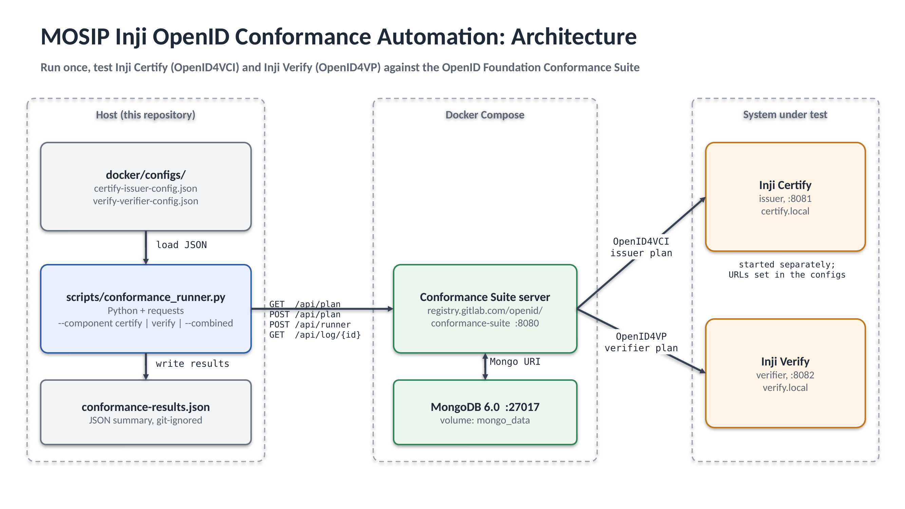
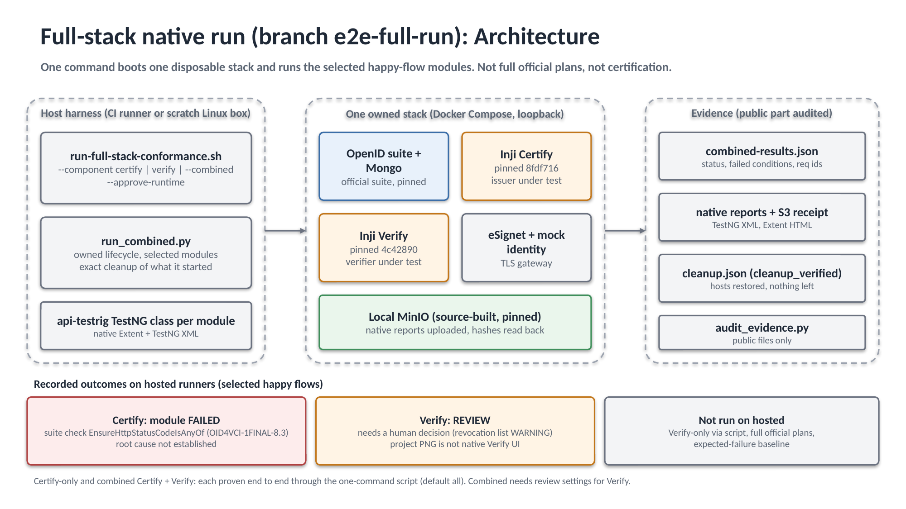

# MOSIP Inji OpenID Conformance Automation

> **Status of branch `e2e-full-run` (2026-10-28). Read this before the older sections below.**
> `main` holds the original suite runner, the standalone api-testrig XML bridge and fixture-only checks.
> The full-stack work lives only on `e2e-full-run`. It starts pinned Inji Certify, Inji Verify, eSignet,
> a mock identity service, the OpenID conformance suite and a source-built local MinIO on one disposable
> stack, runs the **selected happy-flow modules** through a per-component api-testrig TestNG class
> (native Extent/TestNG reports, uploaded to local MinIO and read back), then cleans up and audits the public evidence.
>
> What has actually been run on GitHub-hosted runners (all on `e2e-full-run`):
> * **Certify only, one command (`./run-full-stack-conformance.sh --component certify --approve-runtime`, default all phases):**
>   works end to end (stage, compile, MinIO, stack, run, S3 readback, cleanup verified, evidence audit passed).
>   Result: the suite module `oid4vci-1_0-issuer-happy-flow` ended INTERRUPTED/FAILED. The suite's
>   `EnsureHttpStatusCodeIsAnyOf` check failed (requirement `OID4VCI-1FINAL-8.3`, the credential endpoint response status check). The root cause in the product or the
>   configuration is **not established**. This is a recorded benchmark outcome, not a harness fault.
> * **Combined Certify + Verify**, hosted twice: through the phased workflow (run 40645764342) and through the script's single default-all command (run 40651319058, workflow dispatch `native_component=both`, `script_path=all`, no `--phase`).
>   Both times Certify ended FAILED as above and Verify ended
>   FINISHED with verdict **REVIEW** (native exit codes both 1; conditions `ExpectVerifierSuccessfulVerificationPage=REVIEW`, `EnsureVerifierFetchedRevocationList=WARNING`).
>   REVIEW needs a human decision; the project-rendered PNG is a view of the Verify v2 result API, not a native Verify UI.
> * **Not run on a hosted runner:** Verify-only through the one-command script; full official plans (only selected happy flows are in scope);
>   any expected-failure baseline (none has been recorded, so none is claimed).
> * Nothing here is a certification claim. Failing and REVIEW outcomes are reported as they are; checks are not weakened to turn them green.
>
> The "Quick Start" below is the older existing-environment runner (you supply running Certify/Verify). The full-stack commands are in
> [Full-stack run](#full-stack-run-e2e-full-run-branch).

## Full-stack run (`e2e-full-run` branch)

Dependencies: Linux with Docker (compose v2) and `sudo` (the run edits `/etc/hosts` and restores it), Python 3 with `scripts/requirements.txt`,
JDK 21, Maven, Go (builds MinIO from a pinned source archive), git, network access to GitHub and the image registries. Use a scratch machine or CI runner.
The run boots containers, edits the hosts file and builds MinIO, so it refuses to start without `--approve-runtime`.

```sh
git clone -b e2e-full-run https://github.com/ShrinidhiAR/inji-openid-conformance.git && cd inji-openid-conformance
pip install -r scripts/requirements.txt
export JAVA_HOME=/path/to/jdk21
./run-full-stack-conformance.sh --component certify --approve-runtime     # proven on a hosted runner
./run-full-stack-conformance.sh --component verify  --approve-runtime     # same code path, not yet run hosted
./run-full-stack-conformance.sh --combined          --approve-runtime     # proven hosted via the workflow with review settings; bare local run, see below
```

* Work directory: default is a fresh `mktemp -d`. `CONFORMANCE_WORK` may be set but must be under `/tmp`, and `TMPDIR` must also be under `/tmp`
  (staging and exact cleanup only accept `/tmp`); the script refuses otherwise with exit 2. `--output DIR` must not exist yet (default `combined-conformance-out`).
* `--phase prepare|run|cleanup|audit` splits the steps (needs `CONFORMANCE_WORK`); the default `all` always runs cleanup and audit, even after a failure, and keeps the original exit code.
* Verify needs a human review decision (REVIEW verdict). The GitHub workflow `e2e-full-run.yml` (dispatch mode `native-combined`) does this with a short-lived review window; the one-command script alone does not fake it.
  Without the review settings (`CONFORMANCE_REVIEW_WINDOW`, `CONFORMANCE_REVIEW_DIR`, a read-only `GITHUB_TOKEN`, and a reviewer-committed approval file) a Verify run ends in a deliberate HARNESS_ERROR (`actual_result_evidence_requires_visual_review`), not a verdict.
  So a bare local `--combined` or `--component verify` gives you the Certify result plus that Verify harness error; the REVIEW verdict was only produced on hosted runs that supplied the review settings and an approval (the single default-all `--combined` command did produce it that way, run 40651319058). A bare local run does not fake it.
  The script keeps the token and review settings out of the prepare phase (git, Maven, Go, MinIO); only the run phase sees them.
  The workflow input `script_path` (`phased` default, or `all` for the single default-all command) selects which of the two paths the dispatch uses.
* Output: `combined-results.json` (selected components, native exit codes, per-module status, failed condition names with known requirement ids), native TestNG/Extent reports,
  `local-s3-receipt.json`, `cleanup.json`, a project summary page. Only audited public files are meant to be shared; the private run log stays private.
* Exit codes (as implemented in the default `all` phase): the exit code of the run is kept. A failing module exits non-zero (Certify exits 1 today).
  Cleanup or audit failure prints `cleanup_failed` or `audit_failed` on stderr and only turns an otherwise-zero exit into 2, so **a non-zero exit never proves cleanup was fine**.
  Always check `cleanup.json` (`cleanup_verified: true`) and the audit line `COMBINED_PUBLIC_EVIDENCE_AUDIT_PASS` separately. Refused selections, guards and unsupported phases exit 2 before anything starts.
  Called as separate phases, a failing `cleanup` or `audit` phase exits 2.
* No secret is passed on the command line or in chat; CI uses the repository's `GITHUB_TOKEN` (read-only) only for the Verify review step.
* Hosted CI on the branch: `.github/workflows/e2e-full-run.yml`, manual dispatch only, inputs `mode=native-combined`, `native_component=both|certify|verify`.


Automated local execution and CI/CD pipeline integration for MOSIP Inji Certify (OpenID4VCI) and Verify (OpenID4VP) components using the official OpenID Foundation Conformance Suite.

## Table of Contents
0. [Full-stack run (e2e-full-run branch)](#full-stack-run-e2e-full-run-branch)
1. [Overview](#overview)
2. [Architecture and flow](#architecture-and-flow)
3. [Repository structure](#repository-structure)
4. [Prerequisites](#prerequisites)
5. [Quick Start](#quick-start)
6. [Installation and setup (step by step)](#installation-and-setup-step-by-step)
7. [Usage](#usage)
8. [Configuration](#configuration)
9. [API reference (conformance suite endpoints used)](#api-reference-conformance-suite-endpoints-used)
10. [Output format](#output-format)
11. [api-testrig integration (TestNG + MOSIP report)](#api-testrig-integration-testng--mosips-report)
12. [CI/CD](#cicd)
13. [Test cases](#test-cases)
14. [Test data](#test-data)
15. [Troubleshooting](#troubleshooting)
16. [Known limitations](#known-limitations)

## Overview

MOSIP's Inji stack issues and verifies digital credentials. **Inji Certify** is the issuer (OpenID for Verifiable Credential Issuance, OpenID4VCI) and **Inji Verify** is the verifier (OpenID for Verifiable Presentations, OpenID4VP). The OpenID Foundation publishes a Conformance Suite that checks whether an implementation follows these specifications.

Running the suite by hand through its web UI is slow and hard to repeat. This project automates it:

* Docker Compose starts the conformance suite and its MongoDB database.
* A Python runner (`scripts/conformance_runner.py`) calls the suite's REST API: it creates a test plan, runs every test module in it, waits for each to finish, and records the outcome.
* Results are written to `conformance-results.json`, a plain JSON file meant to be read by a TestNG / ExtentReports test rig or a CI job.

## Architecture and flow

Main-era runner (existing-environment view, branch `main`):



Full-stack native run (branch `e2e-full-run`), with the recorded outcomes:



The diagram is also available as an editable PowerPoint file: [`docs/architecture.pptx`](docs/architecture.pptx).

```text
 conformance_runner.py                 Conformance Suite (Docker)          System under test
 ---------------------                 --------------------------          -----------------
 1. GET  /api/plan  (wait until up) -->  server :8080  <--> MongoDB :27017
 2. POST /api/plan  + JSON config   -->  creates plan, returns its modules
 3. for each module:
      POST /api/runner?test=..&plan=.. -> starts the module  ------------>  Inji Certify (issuer)
      GET  /api/log/{test_id}  (poll) <-  status + result    <-----------  or Inji Verify (verifier)
 4. write conformance-results.json
```

Step by step:

1. The runner waits until the suite's API answers.
2. It reads the JSON config for the component (`docker/configs/...`) and creates a test plan, passing the plan name and variant selection as query parameters.
3. The suite returns the list of test modules in that plan.
4. For each module the runner starts it and polls its log every 3 seconds until its status is terminal (`FINISHED` or `INTERRUPTED`), then records the result.
5. All module outcomes are saved to one JSON file, grouped by component (`certify`, `verify`).

## Repository structure

```text
inji-openid-conformance/
├── docker/
│   ├── docker-compose.yml                    # Conformance suite + MongoDB
│   └── configs/
│       ├── certify-issuer-config.json        # Test plan config for Inji Certify (issuer)
│       └── verify-verifier-config.json       # Test plan config for Inji Verify (verifier)
├── docs/
│   ├── architecture.png                      # Main-era architecture diagram
│   ├── architecture-full-stack.png           # Full-stack native run diagram (e2e-full-run)
│   ├── architecture.pptx                     # Editable source, 2 slides: main-era runner, full-stack run
│   ├── DEMO-GUIDE.md                         # Honest demo/run guide for the branch
│   └── sample-output/                        # Illustrative bridge input/output
├── apitestrig-bridge/                        # Java/TestNG bridge into api-testrig reporting (see below)
│   ├── pom.xml
│   └── src/main/...
├── rig-integration/
│   └── README.md                             # Drop-in steps for inji-certify/api-test and inji-verify/api-test
├── scripts/
│   ├── conformance_runner.py                 # REST API driver
│   └── testng_bridge.py                      # JSON results -> TestNG-style XML (standalone export)
├── .github/workflows/
│   └── conformance-ci.yml                    # CI: harness checks on fixtures + manual live-conformance job
├── .gitignore
└── README.md
```

## Prerequisites

* Docker Desktop (with WSL2 Mirrored Mode enabled on Windows)
* For the api-testrig bridge only: JDK 21 and Maven 3.8+
* Python 3.14+ with `requests`
* Free local ports `8080` (conformance suite) and `27017` (MongoDB)
* Enough memory for several containers: 8 GB RAM minimum, 16 GB comfortable
* A running Inji Certify and/or Inji Verify instance reachable at the URLs in the config files (see [Configuration](#configuration)). This repository does not start them.

## Quick Start (main-era runner; NOT the `e2e-full-run` full-stack path)

> Applies to branch `main` only: it needs your own running Certify/Verify and does not boot the stack, MinIO or the native rig.
> On `e2e-full-run`, use [Full-stack run](#full-stack-run-e2e-full-run-branch) above. The old `--component` runner here has a different interface and is not the verified path.

1. **Start the Conformance Suite & MongoDB:**
   ```powershell
   docker compose -f docker/docker-compose.yml up -d
   ```

2. **Run Certify (Issuer) Conformance Tests:**
   ```powershell
   python scripts/conformance_runner.py --component certify
   ```

3. **Output Artifact:**
   Test results are automatically exported to `conformance-results.json`.

4. **Feed the results into the api-testrig report and gate the build:**
   ```powershell
   cd apitestrig-bridge
   mvn compile exec:java -Dexec.args="--component certify --results ../conformance-results.json"
   ```
   See [api-testrig integration](#api-testrig-integration-testng--mosips-report).

## Installation and setup (step by step)

1. **Clone the repository**
   ```powershell
   git clone https://github.com/ShrinidhiAR/inji-openid-conformance.git
   cd inji-openid-conformance
   ```

2. **Install Docker Desktop** and make sure it is running. On Windows, enable WSL2 and virtualization (BIOS/UEFI setting) first.

3. **Install Python and the dependency**
   ```powershell
   python --version
   pip install requests
   ```
   Optionally use a virtual environment (`python -m venv venv`, then activate it). `venv/` is git-ignored.

4. **Start the suite**
   ```powershell
   docker compose -f docker/docker-compose.yml up -d
   docker compose -f docker/docker-compose.yml ps
   ```
   Both `conformance-mongo` and `conformance-server` should be listed as running. The suite UI opens at <http://localhost:8080>.

5. **Check the config files** in `docker/configs/` point at your Inji instances (see [Configuration](#configuration)).

6. **Run the runner** (see [Usage](#usage)).

7. **Stop everything when finished**
   ```powershell
   docker compose -f docker/docker-compose.yml down
   ```
   Add `-v` to also delete the MongoDB volume (`mongo_data`).

## Usage

```text
python scripts/conformance_runner.py [--component {certify,verify}] [--combined]
                                     [--base-url URL] [--output PATH]
```

| Option | Meaning | Default |
|---|---|---|
| `--component certify` | Run the Inji Certify issuer plan (`oid4vci-1_0-issuer-test-plan`) | none |
| `--component verify` | Run the Inji Verify verifier plan (`oid4vp-1final-verifier-test-plan`) | none |
| `--combined` | Run both plans, certify first, then verify | off |
| `--base-url` | Base URL of the suite REST API | `http://localhost:8080/api` |
| `--output` | Where to write the JSON summary | `conformance-results.json` |
| `--run-id` | Run identifier stamped into the output; pair with the bridge's `--expect-run-id` to bind the gate to this exact run | generated UUID |

You must pass either `--component` or `--combined`; otherwise the script prints an error and exits with code 1.

Examples:

```powershell
python scripts/conformance_runner.py --component certify
python scripts/conformance_runner.py --component verify --output verify-results.json
python scripts/conformance_runner.py --combined
python scripts/conformance_runner.py --component certify --base-url http://localhost:8080/api
```

Console output uses the prefixes `[INFO]`, `[RESULT]` and `[ERROR]`.

## Configuration

### Docker Compose (`docker/docker-compose.yml`)

| Service | Image | Port | Notes |
|---|---|---|---|
| `mongo` | `mongo:6.0` | 27017 | Data kept in the `mongo_data` volume |
| `server` | `registry.gitlab.com/openid/conformance-suite:latest` | 8080 | Dev profile; points at Mongo through `spring.data.mongodb.uri`. The `oauth.clients.*` values are dummy placeholders for local use |

### Test plan configs (`docker/configs/`)

* `certify-issuer-config.json`: the `server.discoveryUrl` is the Inji Certify issuer metadata endpoint (`http://certify.local:8081/.well-known/openid-credential-issuer`). `client.client_id` and `client.client_secret` are test placeholders.
* `verify-verifier-config.json`: `verifier.presentation_definition_uri` is the Inji Verify presentation definition endpoint (`http://verify.local:8082/presentation-definition`).

Edit these URLs to match where your Inji Certify / Inji Verify instances run. If you use the `.local` host names, map them in your hosts file (for example `127.0.0.1 certify.local verify.local`) or replace them with real addresses. Config files may be saved with a UTF-8 BOM; the runner handles that.

### Variants (`scripts/conformance_runner.py`)

`CERTIFY_VARIANTS` selects the test plan options sent to the suite for the issuer plan:

| Variant | Value |
|---|---|
| `fapi_profile` | `vci` |
| `credential_format` | `sd_jwt_vc` |
| `client_auth_type` | `private_key_jwt` |
| `sender_constrain` | `dpop` |
| `vci_authorization_code_flow_variant` | `wallet_initiated` |
| `vci_credential_encryption` | `plain` |
| `vci_grant_type` | `authorization_code` |
| `authorization_request_type` | `simple` |
| `fapi_request_method` | `unsigned` |

`VERIFY_VARIANTS` is empty, so the verifier plan uses the suite defaults.

## API reference (conformance suite endpoints used)

These are the endpoints of the OpenID Conformance Suite that the runner calls. All paths are relative to the base URL (`http://localhost:8080/api`). The runner sends `Content-Type: application/json` and `X-Forwarded-Proto: https` on every request. No authentication is used (local dev profile).

### `GET /plan`
Health check. The runner retries every 3 seconds, for up to 90 seconds, until it gets HTTP 200.

### `POST /plan?planName={plan}&variant={url-encoded JSON}`
Creates a test plan.

* Query: `planName` (for example `oid4vci-1_0-issuer-test-plan`); `variant` (URL-encoded JSON object of variants, omitted when empty).
* Body: the JSON config file contents.
* Response: JSON containing the plan id (`id` or `_id`) and `modules`, the list of test modules (each an object with `testModule`, or a plain name).

### `POST /runner?test={module}&plan={planId}`
Starts one test module of a plan.

* Response: JSON containing the test id (`id` or `_id`).

### `GET /log/{testId}`
Returns the state of a running or finished test. The runner reads two fields:

* `status`: for example `FINISHED`, `REVIEW`.
* `result`: for example `PASSED`, `FAILED`, `WARNING`.

The runner polls every 3 seconds and stops when `status` reaches a terminal value
(`FINISHED` or `INTERRUPTED`). It deliberately does not stop on the `result`
field: per the suite's `TestModule.java`, Status is the lifecycle and Result is
the verdict (`REVIEW` is a result, not a status), and the suite's own automation
library (`scripts/conformance.py`) waits on status alone, so a result value is
only trusted once the module's status is terminal.

Example (shape only):

```text
POST http://localhost:8080/api/plan?planName=oid4vp-1final-verifier-test-plan
     body: contents of docker/configs/verify-verifier-config.json
```

For the full API, see the OpenID Conformance Suite documentation.

## Output format

`conformance-results.json` maps each component to a list of module results, plus a
`run` block identifying when the output was produced:

```json
{
  "run": { "id": "<uuid>", "started_at": "<UTC ISO-8601 timestamp>", "tool": "conformance_runner.py" },
  "certify": [
    { "module": "<test module name>", "test_id": "<id>", "status": "<status>", "result": "<result>" }
  ],
  "verify": [
    { "module": "<test module name>", "test_id": "<id>", "status": "<status>", "result": "<result>" }
  ]
}
```

Only the components you ran appear. The values above are placeholders showing the
structure, not real results. The file is written atomically (a crash can never
leave a truncated file) and is git-ignored. The api-testrig bridge refuses to gate
on a results file without a fresh `run.started_at` (default limit 60 minutes;
`--max-result-age-minutes` overrides), so output from an older or interrupted run
can never satisfy the benchmark.

## api-testrig integration (TestNG + MOSIP's report)

`apitestrig-bridge/` is a small Java 21 / Maven project that turns the runner's
`conformance-results.json` into real TestNG results inside MOSIP's reporting path,
instead of only exporting an XML file:

* `inji.conformance.ConformanceResultsTest` emits one TestNG test per conformance
  module, carrying a `TestCaseDTO` exactly like the rig's own yml-driven tests, so
  module names and conformance-suite test ids land in the same columns of the same
  report the Inji api-test rigs produce.
* The suite XMLs register `io.mosip.testrig.apirig.report.EmailableReport` from
  `io.mosip.testrig.apitest.commons:apitest-commons:1.4.0` (Maven Central) - the
  same listener the Inji rigs register in their master suites - so the output is
  the standard api-testrig HTML report, including its S3/MinIO upload path when
  that is configured.
* `inji.conformance.ConformanceBridgeRunner` runs a suite (certify, verify or
  combined) and gates the build on a benchmark: exit code 0 only when the
  benchmark is met.

Run it after the runner has produced results:

```powershell
python scripts/conformance_runner.py --component certify
cd apitestrig-bridge
mvn compile exec:java -Dexec.args="--component certify --results ../conformance-results.json"
```

Reports land in `apitestrig-bridge/testng-report/` (full and error HTML reports
plus `gate-summary.json`).

### Benchmark gate

The problem statement requires benchmark gating but states no numeric benchmark,
so the gate is a configurable project policy, fail-closed by default:

* a module must have reached status `FINISHED` to count at all: `INTERRUPTED`
  or any non-terminal status fails the gate regardless of the recorded result,
  even `PASSED`;
* a finished module must pass. By default it passes with result `PASSED`, or with
  result `WARNING` while `benchmark.allowWarnings=true` (the default), in which
  case it is flagged in the report for manual review; set
  `-Dbenchmark.allowWarnings=false` to require a literal `PASSED`. `FAILED`,
  `REVIEW` (needs manual review), `SKIPPED`, `UNKNOWN` and missing results all
  fail the gate, as do an empty result set and a missing results file;
* freshness and run identity are enforced: the runner deletes any previous output
  before starting (a crashed or interrupted run leaves no file), stamps every
  output with `run.id` and `run.started_at` and writes the file atomically, and
  the bridge refuses any results file without a timestamp, older than
  `--max-result-age-minutes` (default 60), or - when `--expect-run-id` is given -
  from any other run;
* residual limit: the gate judges what is in the results file. It cannot verify
  that the conformance suite's plan itself contained every official module - only
  that every module the suite returned was run and passed. Someone hand-editing
  results is outside what tooling can prevent;
* `--min-pass-rate N` (0-100, default 100) overrides the pass-rate threshold.

### Two run modes (per the problem statement)

* **Per-module (default):** drop the test class and suite file into
  `inji-certify/api-test` or `inji-verify/api-test` so the conformance results run
  inside that module's own rig and report. Step-by-step:
  [`rig-integration/README.md`](rig-integration/README.md).
* **Combined:** run both components in one suite here with
  `--component combined`.

### Verification status

* **Verified by us:** the bridge compiles and runs on JDK 21 with apitest-commons
  1.4.0; `EmailableReport` generates the standard api-testrig report from our
  TestNG results; the gate passes on passing data and fails the build on failing
  and on empty data. CI re-runs these checks on every push using fixture data
  (clearly labelled as fixtures, not live conformance).
* **Not run by us:** execution inside the full `InjiTestRunner` (it needs a MOSIP
  environment with Keycloak/PMS), the S3/MinIO upload (needs MOSIP's S3
  configuration), and a live conformance run against real Inji Certify / Inji
  Verify instances. `EmailableReport` needs an `env.endpoint` system property as a
  report label; the bridge runner sets a placeholder one.

### Standalone XML export

`scripts/testng_bridge.py` remains as a lightweight converter from
`conformance-results.json` to TestNG/JUnit-style XML for tools that consume those
reports (for example Jenkins):

```powershell
python scripts/conformance_runner.py --combined
python scripts/testng_bridge.py
```

Options:

| Option | Meaning | Default |
|---|---|---|
| `--input` | Runner output JSON | `conformance-results.json` |
| `--output` | XML file to write | `testng-results.xml` |
| `--format junit` | `<testsuites><testsuite><testcase>` layout | default |
| `--format testng` | Native `<testng-results><suite><test><class><test-method>` layout | |
| `--strict-warnings` | Treat `WARNING` results as failures | off |

Mapping: one suite per component (`certify`, `verify`), class name
`inji.<component>.conformance`, test name = suite module name. `PASSED` passes,
`WARNING` passes with a note (fails with `--strict-warnings`), `FAILED` fails,
anything else is marked skipped. The runner does not record durations, so all time
values are `0`.

`docs/sample-output/` holds an **illustrative** input and the XML the bridge
produced from it. The module names and results in that sample are made up to show
the mapping. They are not results of a real conformance run. The XML export parses
correctly; unlike the Java bridge above it is not wired into the api-testrig's own
reporting.

## CI/CD

`.github/workflows/conformance-ci.yml` is the GitHub Actions workflow, active on
every push to `main`. It has two jobs:

* **Harness checks (every push and PR):** compiles the Python and Java code, runs
  the standalone XML bridge on the illustrative sample, and proves the benchmark
  gate passes on an all-pass fixture and fails the build on failing and on empty
  fixtures. These checks use fixture data only; a green run means the harness and
  the gate work, not that any live Inji component passed conformance.
* **Live conformance (manual dispatch):** starts the conformance suite with Docker
  Compose, points the plan configs at reachable Inji Certify / Inji Verify
  endpoints (set the repository variables `INJI_CERTIFY_URL` and
  `INJI_VERIFY_URL`), runs the runner, then gates the build through the
  api-testrig bridge. With no reachable endpoints the gate fails closed by
  design, so a misconfigured run can never look like a pass. No credentials are
  stored in this repository; endpoints are GitHub repository variables.

## Test cases

These are procedures to follow and the outcome to expect. They describe what the harness should do; they are not recorded results.

| ID | Procedure | Expected outcome |
|---|---|---|
| TC-01 Suite starts | Run `docker compose -f docker/docker-compose.yml up -d`, then `docker compose -f docker/docker-compose.yml ps` | `conformance-mongo` and `conformance-server` are running; <http://localhost:8080> loads |
| TC-02 Health wait | Start the runner while the suite is still booting | Console prints `[INFO] Waiting for Conformance Suite...` and then `[INFO] Conformance suite is up and running.` |
| TC-03 Suite not running | Run `docker compose -f docker/docker-compose.yml down`, then run the runner | After 90 seconds the runner stops with a `TimeoutError` saying the suite did not become ready |
| TC-04 No component given | Run `python scripts/conformance_runner.py` with no options | Prints `[ERROR] Please specify --component [certify\|verify] or --combined` and exits with code 1 |
| TC-05 Certify plan | With Inji Certify reachable, run `--component certify` | A plan is created (`[INFO] Created test plan: <id> ...`), each module is run, a `[RESULT]` line is printed per module, and `conformance-results.json` has a `certify` list |
| TC-06 Verify plan | With Inji Verify reachable, run `--component verify` | Same as TC-05, with a `verify` list in the output |
| TC-07 Combined run | Run `--combined` | Certify plan runs first, then verify; the output file has both `certify` and `verify` lists |
| TC-08 Custom output path | Run `--component certify --output out.json` | Results are written to `out.json` instead of the default file |
| TC-09 Missing config | Rename `docker/configs/certify-issuer-config.json` and run `--component certify` | The runner fails with a file-not-found error before any test starts (restore the file afterwards) |
| TC-10 Invalid config JSON | Break the JSON syntax in a config file and run the matching component | The runner fails with a JSON parse error before any test starts (restore the file afterwards) |
| TC-11 BOM tolerance | Save a config file with a UTF-8 BOM (as PowerShell does) and run the matching component | The config loads normally |
| TC-12 Git hygiene | Run the runner, then `git status` | `conformance-results.json` is not listed as untracked (it is in `.gitignore`) |

## Test data

All values are placeholders for local testing and are not real credentials:

* Config client: `client_id` = `conformance-test-client`, `client_secret` = `test-secret`.
* Issuer metadata URL: `http://certify.local:8081/.well-known/openid-credential-issuer`.
* Presentation definition URL: `http://verify.local:8082/presentation-definition`.
* Conformance suite OAuth client values in `docker-compose.yml`: `dummy-client-id` / `dummy-client-secret`.

## Troubleshooting

### Full-stack run (`e2e-full-run`)

| Symptom | Meaning and next step |
|---|---|
| `refusing: this boots docker containers ... pass --approve-runtime` (exit 2) | Deliberate guard. Re-run with `--approve-runtime` only on a scratch machine or CI runner |
| `CONFORMANCE_WORK must be under /tmp` or `TMPDIR must be under /tmp` (exit 2) | Staging and exact cleanup only accept `/tmp`. Unset `TMPDIR` or point both under `/tmp`. Do not use `RUNNER_TEMP` |
| `--phase X needs CONFORMANCE_WORK` (exit 2) | Split phases share one work directory; export it (under `/tmp`) |
| `fresh_evidence_directory_required` | `--output` already exists. Pick a new directory |
| `new_temporary_destination_required` | The staged rig directory already exists or is outside `/tmp`. Use a fresh work directory |
| `mvn: command not found`, `go: command not found` | Install Maven and Go. They are required for the prepare step |
| `cleanup_failed` / `audit_failed` on stderr | Look at `cleanup.json` (`cleanup_verified`) and the audit output. If cleanup is not verified, check `docker compose ls`, leftover `conformance-*` projects and `/etc/hosts`; the run's original exit code can still be 1 |
| Exit 1 and a module `FAILED` in `combined-results.json` | A recorded benchmark outcome, not a harness fault. See `conditions` for the failed suite check and requirement id |
| Verify verdict `REVIEW` | Human decision required by the suite; the harness does not turn it green |

### Main-era runner (`main`)

| Symptom | Likely cause and fix |
|---|---|
| `TimeoutError: Conformance suite ... did not become ready` | The suite is not running or still starting. Check `docker compose -f docker/docker-compose.yml ps` and `docker compose -f docker/docker-compose.yml logs server`, wait a minute, retry |
| Port 8080 or 27017 already in use | Stop the program using the port, or change the left side of the port mapping in `docker-compose.yml` and pass the new address with `--base-url` |
| Docker says virtualization is not enabled | Turn on virtualization in BIOS/UEFI and enable WSL2 in Windows features |
| Image pull fails for `conformance-suite` | Check your internet connection and that you can reach `registry.gitlab.com`; retry `docker compose ... pull` |
| `FileNotFoundError` for a config file | Run the script from the repository root, because config paths are relative (`docker/configs/...`) |
| `ModuleNotFoundError: No module named 'requests'` | Run `pip install requests` |
| HTTP 4xx/5xx from `POST /plan` | The plan name, variants or config are not accepted by your suite version. Check the runner's plan names against the suite's available plans in the web UI at <http://localhost:8080> |
| Connection errors from the suite to Inji Certify / Verify | The URLs in `docker/configs/` are not reachable from the suite container. Check host names, ports and firewall |
| A test module never finishes | See Known limitations below |
| Garbled first character when reading a config in a text editor | The file has a UTF-8 BOM; this is harmless for the runner |

## Known limitations

* The runner polls each test with no overall time limit. A module that waits for a manual step (for example a wallet action in the suite UI) will keep the runner waiting until the step is done in the UI at <http://localhost:8080>.
* (Applies to the older runner on `main`.) The compose file starts only the conformance suite and MongoDB. Inji Certify and Inji Verify must be started separately.
* On `main`, the api-testrig bridge is verified on fixture data only. On `e2e-full-run` the per-component native TestNG class, local MinIO upload with readback, and live Certify/Verify happy-flow runs have been executed on hosted runners (see the status block at the top); full official plans and an expected-failure baseline have not.
* The `latest` tag of the suite image is not pinned, so behavior can change when the image is updated.
